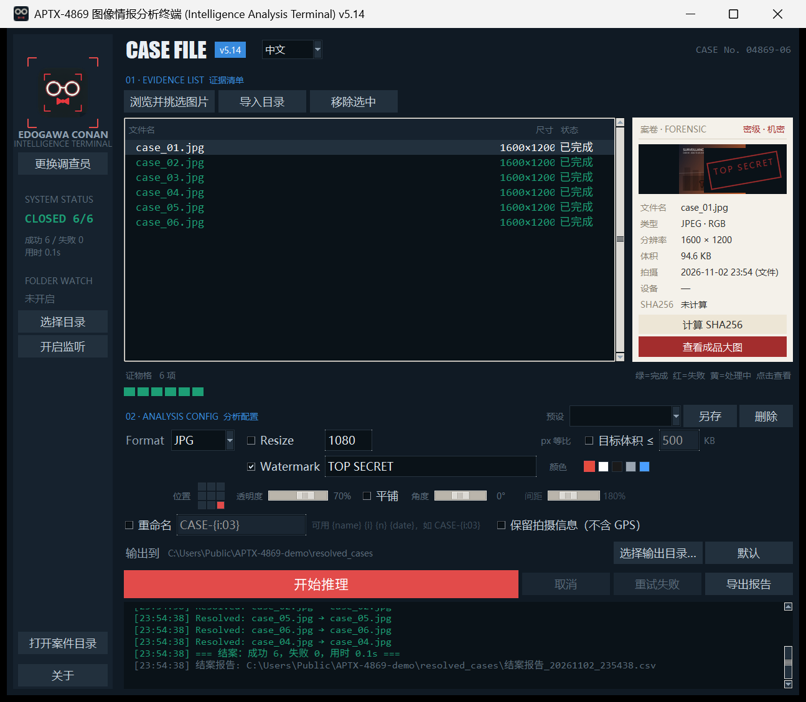

# 侦探工具箱 v5.14.1 · 使用说明与演进记录

> **English** — APTX-4869 is a batch image processor for Windows: convert formats, resize, watermark, compress to a target file size, batch rename, and watch a folder for new images. Single exe, fully offline, no installer, MIT licensed.
> **[Read the English manual →](README_EN.md)** · **[Download v5.14.1](https://github.com/jinferth/aptx-4869/releases/latest)**

> APTX-4869 图像情报分析终端 —— 一个放在桌面的批量图片处理器。
> 转格式、缩放、加水印、看成品，全部在一个窗口里完成，不需要联网。

**中文说明** · [English manual](README_EN.md)



> 左：系统状态与文件夹监听 · 中：证据清单 · 右：选中图的案卷卡（信息与成品预览）
> 下：分析配置（格式 / 缩放 / 水印 / 目标体积）与逐张处理日志

---

## 目录

1. [快速开始](#一快速开始)
2. [界面导览](#二界面导览)
3. [标准操作流程](#三标准操作流程)
4. [三个处理参数](#四三个处理参数)
5. [证物格与成品预览](#五证物格与成品预览)
6. [输出规则（重要）](#六输出规则重要)
7. [快捷键](#七快捷键)
8. [常见问题](#八常见问题)
9. [提升点：相对 v5.2 做了什么](#九提升点相对-v52-做了什么)
10. [已知限制](#十已知限制)
11. [后期发展路线](#十一后期发展路线)
12. [文件清单与重新打包](#十二文件清单与重新打包)

---

## 一、快速开始

### 方式一：直接运行（推荐）

双击 `dist\侦探工具箱_v5.13.exe`

> v5.14 起发布件在 `release\` 目录：`APTX-4869_v5.14.1.exe`（英文名）、`侦探工具箱_v5.14.1.exe`（中文名）、`SHA256.txt`、`RELEASE_NOTES.md`、`LICENSE` 与两份说明书。

- 单文件程序，**首次启动需要 2–4 秒**：它要把内置的 Python 运行时解压到临时目录，第二次启动会快一些。这不是卡死，不要重复双击。
- 程序不需要安装、不写注册表、不联网。

### 方式二：从源码运行

需要 Python 3.10+，并且带 tkinter（Windows 官方安装包默认包含），以及 Pillow：

```bash
pip install pillow
python image_processor_pro.py
```

本机验证过的环境：`D:\Python314\python.exe`（3.14 + Pillow 12 + tkinter 8.6）。

> 注意：默认的 Python 环境如果没有装 tkinter，会直接报 `No module named 'tkinter'`，需要换用带 tkinter 的解释器。

---

## 二、界面导览

界面分左右两块：左边是**暗房侧栏**，右边是**工作台 + 案卷卡**。

```
┌──────────┬────────────────────────────────────────────┬──────────────┐
│ 取景框   │  CASE FILE  v5.14.1          CASE No. 04869-07 │ 案卷·FORENSIC│
│ 图标     │                                            │ 密级·机密    │
│          │  01 · EVIDENCE LIST  证据清单               │ ┌──────────┐ │
│ EDOGAWA  │  [浏览并挑选图片][导入目录][移除选中]        │ │ 缩略图    │ │
│ CONAN    │  ┌──────────────────────────────┐          │ │  TOP     │ │
│          │  │ 文件名        尺寸      状态  │          │ │ SECRET章 │ │
│ SYSTEM   │  │ 1.jpg      200×400   已完成  │          │ └──────────┘ │
│ STATUS   │  │ broken.jpg           失败    │          │ 文件名 …     │
│          │  └──────────────────────────────┘          │ 类型 尺寸 …  │
│ 6/7 FAIL │  证物格 7 项  ■■■■■■■                      │ 体积 拍摄 …  │
│ 进度 6/7 │  02 · ANALYSIS CONFIG  分析配置             │ SHA256 …     │
│          │  Format[JPG] ☐Resize ☐目标体积 ☐Watermark    │ [查看成品大图]│
│          │  输出到 …\custom_out     [选择目录][默认]   │ [计算SHA256] │
│ [打开     │  [开始推理] [取消] [重试失败(1)] [导出报告] │              │
│ 案件目录] │  日志区                                    │              │
└──────────┴────────────────────────────────────────────┴──────────────┘
```
| 区域 | 作用 |
|---|---|
| 左上取景框 | 当前"调查员"图标。点「更换调查员」可换成本地图片，仅本次运行有效 |
| 左侧 SYSTEM STATUS | `READY · N` 待处理 / `PROCESSING` 处理中 / `CLOSED 12/12` 全部成功 / `4/5 · 1 FAIL` 有失败 |
| 左侧进度 | 已处理数/总数与百分比、成功失败数、总耗时 |
| 左下按钮 | 处理过一次之后点亮，直接打开本次输出目录 |
| 证据清单 | 三列：文件名、成品尺寸、状态。状态用颜色区分：灰=待处理、黄=处理中、绿=完成、红=失败 |
| 证物格 | 每个文件一格方块，一眼看整体进度和哪张出错（详见第五节） |
| 输出到 | 本次成品写到哪。默认是「第一张图所在目录 / resolved_cases」，可点「选择目录」换位置，「默认」还原 |
| 案卷卡 | 选中某一行时显示它的取证信息：类型、尺寸、体积、拍摄时间、设备、SHA256 |
| 日志区 | 带时间戳的运行记录。绿色=成功，红色=失败，灰色=补充说明 |

---

## 三、标准操作流程

1. **加图**（三种方式任选）
   - **直接把图片或文件夹拖进窗口**：最快的方式，文件夹会按当层展开。
   - 「浏览并挑选图片」：打开文件对话框，按住 `Ctrl` 多选，能直接看到缩略图。支持 jpg / jpeg / png / bmp / webp / ico / tif / tiff / gif。
   - 「导入目录」：一次导入某个文件夹下所有支持的图片（**不递归子文件夹**）。
   - 重复添加同一个文件会被自动跳过，不会重复入列。

2. **确认清单**
   列表里会显示文件名和状态。想删掉某条：选中后按 `Delete`，或点「移除选中」，或右键菜单。支持 `Ctrl` / `Shift` 多选批量删。

3. **选参数**（见第四节）
   不选也行，默认就是「转 JPG + 不缩放 + 不加水印」。

4. **点「开始推理」**
   处理在后台线程跑，界面不会假死。每张图的状态会实时变成黄→绿/红，证物格同步变色。

5. **看结果**
   - 处理完会弹一个汇总框：成功几张、失败几张、耗时、输出位置。
   - 自动选中第一张成功的，案卷卡显示它的信息。
   - 点「查看成品大图」或双击列表行，打开预览窗看成品。
   - 点左下「打开案件目录」直接跳进输出文件夹。

6. **收尾三件事（仅在有失败或想看数据时）**
   - **取消**：处理到一半发现选错，点「取消」，当前这张跑完就停，已完成的不会回滚。
   - **重试失败**：按钮上会显示失败数量，点一下只重跑失败的那几张，成功的不会被重复处理。
   - **导出报告**：每次处理完会自动在输出目录生成一份 CSV 结案报告，点「导出报告」用 Excel 打开。

7. **让程序自己盯一个文件夹（可选）**
   左侧栏的 `FOLDER WATCH` 区：点「选择目录」指定一个文件夹，再点「开启监听」。
   之后**任何落进这个文件夹的新图片都会被自动处理**，用的就是当前这套参数。

   这适合固定工作流：先把格式、缩放、水印调好，然后一直开着监听，把图往那个文件夹里一丢就行。

   监听的几条规则（都是为了避免出错，不是限制）：

   - **文件写完才处理**。程序会盯着文件大小和修改时间，连续两次观测一致、且距离首次发现已过 2 秒，才认为拷贝完成。所以大文件复制到一半时不会去读它，也不会报错
   - **同一个文件只处理一次**。按「路径 + 大小 + 修改时间」记账；如果你用同名文件覆盖了它，会被当成新版本重新处理
   - **产物不会被二次处理**。输出目录如果是监听目录下的 `resolved_cases`，扫描时会自动跳过，否则会陷入"处理产物 → 又被当成新文件"的死循环
   - **处理中到达的文件会排队**，等这一轮结束再跑，不会丢
   - **不弹汇总框**，只在日志里记一行，避免每落一批图就打断你一次
   - **只扫当层，不递归子文件夹**；监听状态不会保存，程序重启后需要手动再点一次「开启监听」（目录会记住）

8. **切换界面语言（v5.13 新增）**

   顶部标题栏右侧的 `English` 下拉就是语言开关，选「中文」或「English」**立即生效**，不用重启程序。
   选择会记在配置里，下次启动还是这个语言。

   跟着切换的不只是按钮文字，而是整个界面：证据清单表头与状态列、证物格、
   分析配置各控件、监听区、结案摘要、处理日志、弹窗、成品预览窗、窗口标题，
   连结案报告的**表头和文件名**也会变成英文（`case_report_时间戳.csv`）。

   > 已写进日志的历史记录不会被追溯翻译——那是当时发生的事。
   > 用户自己保存的预设名也不翻译，因为那是用户自己的命名。

9. **键盘快捷键（v5.12 新增）**

   | 快捷键 | 作用 | 备注 |
   |---|---|---|
   | `Ctrl+O` | 打开文件选择框加图 | 处理进行中不会触发 |
   | `Ctrl+Enter` | 开始推理 | 列表为空或正在处理时不会触发 |
   | `Esc` | 取消当前处理 | 只在处理进行中才生效 |

   并行批处理默认开启（多核机器上会同时跑多个文件，日志里能看到 `[PARALLEL] 工作线程 N`）；
   大图缩放前会先降采样，减少内存占用。若想关掉并行，把 `%APPDATA%\DetectiveToolbox\settings.json`
   里的 `parallel` 改成 `false` 即可。

---

## 四、三个处理参数

### Preset（预设方案）

配置区右上角的下拉框，一键套用整套参数：

| 内置预设 | 效果 |
|---|---|
| 微信配图 | JPG · 最长边 1280 · 目标 300KB · 无水印 |
| 网页 WEBP | WEBP · 最长边 1600 · 目标 200KB · 无水印 |
| 图标 ICO | ICO · 不缩放 · 无水印 |
| 原图直转 | JPG · 不缩放 · 不压体积 · 无水印 |

改完参数后点「另存」，输入名字就存成自己的预设，下次启动还在。「删除」只对自定义预设有效——内置那四个写在代码里，删不掉也改不坏，避免手滑之后无法恢复。

> 预设存的是整套处理参数（格式、缩放、水印全部七项、目标体积、元数据）。**输出目录不在预设里**，因为它属于"这次往哪放"，不属于"怎么处理"。

### Format（输出格式）

`JPG` / `PNG` / `BMP` / `WEBP` / `ICO`

| 情况 | 行为 |
|---|---|
| 转 JPG / BMP | 没有透明通道，透明区域会被**填充成白色**（不是黑色） |
| 转 PNG / WEBP | 保留透明通道 |
| 转 ICO | 自动生成 16/24/32/48/64/128/256 多尺寸帧，但**不会超过原图尺寸**；输出的图标最大 256px |

JPG 固定质量 95 并开启 optimize；WEBP 质量 95。这两个数值目前不可调。

### Resize（缩放）

勾选后填一个像素值（默认 1080），程序按**等比**把最长边缩到这个值以内：

- 原图 4000×3000 + 填 1080 → 输出 1080×810
- 原图 800×600 + 填 1080 → **不放大**，保持 800×600
- 输入框只能填数字；填了非法内容会退回 1080 并在日志里提示

### Target size（目标体积）—— 可选，默认关闭

勾上后填一个 KB 数（默认 500），程序会在**不改变尺寸**的前提下自动把质量调到能塞进这个体积的最大值。

- **只对 JPG / WEBP 有效**。选 PNG / BMP / ICO 时这一组会自动置灰——无损格式谈目标体积没有意义
- 工作原理：对质量做二分查找（1–95），取"能达标里的最高质量"。一张图最多 7 次内存编码，不产生临时文件
- 已经够小的图不会被无谓压缩：比如纯色图本来 15KB，目标 60KB，它仍用质量 95 输出
- 和 Resize 是叠加关系：先缩放尺寸，再压体积。想要又小又清楚，正确顺序是**先 Resize 缩尺寸，再设体积上限**

**达标不了会告诉你**：如果压到质量 1 仍超过目标，报告里那一行会用 `*` 标出，日志里也会汇总警告。质量被压到 20 以下时同样会提醒——通常是尺寸太大，该先 Resize。

### Watermark（水印）—— 可选，默认关闭

**这是整个工具里唯一"可以完全不用"的功能**：不勾选就不会写入任何水印像素，输出图与源图逐像素一致（已用无损格式验证过）。

未勾选时，下面的位置、透明度、平铺全部置灰不可点，缩略图也不会叠水印——不会出现"看起来设了但没生效"或"没设却被加上"的情况。

勾选后有四组参数：

| 参数 | 说明 |
|---|---|
| **文字** | 默认 `TOP SECRET`，可直接改 |
| **颜色** | 右侧五个色块点选：红 / 白 / 黑 / 灰 / 蓝。浅色底选白或黑，深色底选白，红蓝用于主题感 |
| **位置** | 左边那个 3×3 方格点选，九个位置任选，默认右下角 |
| **透明度** | 0–100% 滑杆，默认 70%。调到 0% 等于不画 |
| **平铺** | 勾上后整幅交错铺满，此时"位置"不生效 |
| **角度** | -45°–+45°，单点和平铺都生效，斜向水印用 -30° 左右最自然 |
| **间距** | 110%–320%，只在勾选平铺时可用。数字越大铺得越稀 |

四条固定规则：

- 字号跟着图片大小走：起始值约为短边的 4%（不低于 10px），文字太长会自动缩到放得下为止
- 顺序是「先缩放、后加水印」，所以水印大小按**成品尺寸**算，不是原图
- 描边色按文字亮度自动取反（深色字配白边、浅色字配黑边），保证在深浅背景上都立得住；平铺时会补上贴边的最后一行一列，避免边缘留出干净白带

**实时预览**：改文字、拖滑杆、点九宫格，案卷卡里的缩略图会立刻重绘，不用先跑一遍再回来调。

> 已知边界：图片极小（比如 40×30）时，水印只能显示一小截；平铺的间距和角度目前是自动算的，不能手动调。

---

## 五、证物格与成品预览

### 证物格

一排小方块，每个方块对应清单里的一个文件：

| 颜色 | 含义 |
|---|---|
| 灰色 | 待处理 |
| 黄色 | 正在处理 |
| 绿色 | 已完成 |
| 红色 | 失败 |

- 鼠标悬停显示文件名和状态
- 点一下：跳到清单里对应的那一行，案卷卡同步显示它的信息
- 点**已完成**的方块：直接打开成品预览窗
- 文件超过 120 个时，右侧会显示 `+N` 表示还有多少没画出来

### 成品预览窗

| 操作 | 效果 |
|---|---|
| 「适应窗口」 | 整张图完整显示；图比窗口小时不放大，保持原始大小并居中 |
| 「1:1」 | 按原尺寸显示，超出部分用滚动条查看 |
| 鼠标滚轮 | 在 25%–200% 之间按档位缩放 |
| 按住左键拖动 | 平移查看大图局部 |
| 「对比原图」 | 在原图与成品之间切换，用来检查缩放/水印效果 |
| 「所在目录」 | 打开成品所在的文件夹 |
| `Esc` | 关闭预览窗 |

顶部信息栏会显示：图片实际尺寸、当前显示比例、文件大小。

> 注意：如果某张图处理失败，点它看预览会回退去打开原图。原图本身损坏时会弹「该文件无法解码」提示，不会开出一个空窗口。

---

## 六、输出规则（重要）

### 输出位置

统一输出到 **清单里第一张图片所在目录** 下的 `resolved_cases` 文件夹：

```
D:\照片\2026\resolved_cases\1.jpg
```

这个目录在第一次点「开始推理」时自动创建。

想换位置就点配置区下方的「选择目录」，选中的目录会成为新的输出位置，并且**下次启动会记住**；点「默认」还原成上面的规则。

> 注意默认规则的一个行为：如果你从**两个不同文件夹**导入图片且没有指定输出目录，所有成品都会集中到**第一个文件夹**的 `resolved_cases` 里，而不是各自目录。指定一个固定输出目录可以避免这个问题。

### 文件命名

- 默认沿用原文件名，只换扩展名：`photo.jpg` → `photo.png`
- **同名不覆盖**：如果目标已存在，自动加后缀 `photo_1.png`、`photo_2.png`
- 所以重复处理同一批图不会丢文件，但会累积出 `_1` `_2` 副本，需要自己清理

### 方向校正

程序会自动读取 EXIF 方向标记并校正。手机竖拍的照片转出来是正的，不会躺倒。

### Rename（批量重命名）—— 可选，默认关闭

勾上后填一个命名模板，成品按模板改名。支持四个占位符：

| 占位符 | 含义 | 例子 |
|---|---|---|
| `{name}` | 原文件名（不含扩展名） | `photo` |
| `{i}` | 序号，从 1 开始 | `7` |
| `{i:03}` | 序号补零到 3 位 | `007` |
| `{n}` | 本批总数 | `20` |
| `{date}` | 处理日期 | `20261029` |

几个例子：

```
CASE-{i:03}        →  CASE-001.jpg  CASE-002.jpg  …
{date}-{i:04}      →  20261029-0001.jpg
{name}_web         →  photo_web.jpg  （保留原名，只加后缀）
```

三条行为约定：

- **序号按清单顺序**，也就是你在列表里看到的顺序；想改顺序先调整清单
- 模板里的 Windows 非法字符（`\ / : * ? " < > |`）自动替换成下划线，不会因为一个字符让整批失败
- 重名照旧不覆盖，自动加 `_1` `_2`；所以同一批跑两次会得到两套文件，不会互相顶掉

> 重命名只影响**成品文件名**，证据清单里显示的一直是原文件名，"文件名 → 成品名"的对应关系在结案报告里能对上。

### 元数据（拍摄信息）

默认**不保留任何元数据**，成品里没有机型、没有拍摄时间、更没有 GPS 坐标。

需要保留拍摄信息时，勾上配置区最下面那个「保留拍摄信息（不含 GPS）」：

| 会保留 | 不会保留 |
|---|---|
| 相机品牌（Make） | **GPS 坐标** |
| 相机型号（Model） | 厂商私有 MakerNote |
| 拍摄时间（DateTime / DateTimeOriginal） | 缩略图、镜头、曝光等其余字段 |

这是一个刻意的取舍：整理照片时"这台机器什么时候拍的"有用，而"在哪个经纬度拍的"是最不该随图流出去的东西。所以没有做"全保留"，只给了这一份白名单。

> 仅对 JPG / WEBP 生效。PNG、BMP、ICO 没有标准的 EXIF 承载位置，勾了也不会写。

### 结案报告

每次处理完，会在输出目录生成 `结案报告_年月日_时分秒.csv`，一行一张图：

| 列 | 内容 |
|---|---|
| 序号 / 文件名 / 状态 | 成功还是失败 |
| 源尺寸 → 成品尺寸 | 例如 5000×3000 → 1200×720 |
| 源体积 → 成品体积 | 以及体积变化百分比（`-44.3%` 这种） |
| 质量 | 最终使用的 JPEG/WEBP 质量值（1–95）；带 `*` 表示压到 1 仍超过目标体积 |
| 耗时(ms) | 单张处理耗时，用来找出拖慢批量的那张 |
| 成品文件 / 错误原因 | 失败时这里会写明原因 |

用 Excel 直接打开不会乱码（文件带 BOM）。多轮处理会生成多份报告，文件名带时间戳不会互相覆盖。

### 原始文件

**永远不修改原图**。所有操作都在内存里做完后写到新文件。

---

## 七、快捷键

| 位置 | 按键 | 作用 |
|---|---|---|
| 证据清单 | `Delete` / `BackSpace` | 移除选中项 |
| 证据清单 | 双击 | 打开成品预览 |
| 证据清单 | 右键 | 菜单：查看成品大图 / 移除此线索 / 清空列表 |
| 整个窗口 | 拖入文件 | 导入图片，拖入文件夹按当层展开 |
| 预览窗 | `Esc` | 关闭 |
| 预览窗 | `+` / `-` | 放大 / 缩小一档 |
| 预览窗 | 滚轮 | 缩放 |

> 全局快捷键：`Ctrl+O` 加图、`Ctrl+Enter` 开始推理、`Esc` 取消（仅在处理进行中生效）。

### 关于（About）

点侧栏底部的「关于」，或者点标题栏上的版本徽标，能看到：

| 项 | 内容 |
|---|---|
| 版本 / 构建时间 | 当前版本号，以及这个 exe 是什么时候构建的 |
| 体积 | 当前程序文件多大 |
| 数字签名 | **本程序没有做代码签名**。从网上下载时 Windows 会拦一下，需要点「更多信息 → 仍要运行」 |
| 配置目录 | 参数存在哪个文件里（`%APPDATA%\DetectiveToolbox\settings.json`） |
| SHA256 | 当前 exe 的校验和，可点「复制校验和」贴到别处核对 |
| 许可证 | **MIT 许可**：可自由使用、修改、再分发（含商业用途），保留版权声明即可。完整条款见项目根目录的 `LICENSE` |

> 签名这一栏不是写死的：程序直接读 PE 头里的安全目录，有证书就算「已签名」。
> 哪天你给它签了名，这一栏会自动跟着变。

---

## 八、常见问题

**Q：双击 exe 没反应，等了几秒才出窗口？**
单文件打包的程序启动时要解压运行时，2–4 秒属正常。二次启动会快一些。

**Q：处理到一半卡在一个文件不动了？**
超大图（比如 8000×6000）解码需要时间，进度会停在那一张。等它跑完即可。也可以点「取消」——当前这张跑完就停，已完成的不会回滚（原图不受影响）。

**Q：为什么成品里多出 `xxx_1.jpg`？**
说明输出目录里已经有同名文件了。程序不会覆盖，只会另起名字。清理旧的 `resolved_cases` 目录可以避免。

**Q：为什么透明 PNG 转出来白底？**
JPG 和 BMP 格式本身不支持透明，程序把它铺成白色。需要透明就选 PNG 或 WEBP。

**Q：水印怎么跑到右下角，位置能改吗？**
可以改。左边那个 3×3 方格点选九个位置任选，还能调颜色、透明度、角度，平铺模式下另有间距可调。

**Q：拖进去没反应？**
只有图片文件和文件夹能拖入；处理进行中会拒绝新拖入（日志会提示）。如果日志第一行写的是「拖拽导入不可用」，说明当前环境缺少拖拽组件，用「浏览并挑选图片」即可，其他功能不受影响。

**Q：取消之后已完成的还有效吗？**
有效。取消只是停止继续处理，已经写出的成品文件都保留，也会照常生成这份报告。

**Q：某几张总是失败？**
看日志里的红字，通常是这几种：文件损坏或截断、格式其实不被 Pillow 支持（比如扩展名是 jpg 但内容是别的）、文件被其他程序独占、原目录没有写权限。失败只影响那一张，其余照常处理完。

**Q：参数每次都要重设？**
不用了。格式、缩放、水印、输出目录都会记住，下次启动自动恢复。想回到出厂默认，关掉程序后删掉 `%APPDATA%\DetectiveToolbox\settings.json` 即可。

**Q：窗口在小屏幕上显示不全？**
窗口高度是按内容自适应计算的，屏幕可用高度不够时会自动压到屏幕内，此时日志区可能被压缩。建议 1080p 及以上分辨率使用。

---

## 九、提升点：相对 v5.2 做了什么

从 v5.2 到现在的 v5.14.1，改动分两类：**先修正确性，再做视觉，最后解决日常摩擦**。顺序很重要——一个会卡死的程序，界面再好看也没人用；界面再顺，每次都要重设参数也留不住人。

### 9.1 稳定性与正确性（v5.3）

| 问题（v5.2） | 后果 | 处理方式 |
|---|---|---|
| 后台线程直接操作 Tk 控件 | Tcl/Tk 非线程安全，偶发界面卡死或崩溃 | 改为 `queue.Queue` + 主线程定时泵，子线程只入队，一次都不碰控件 |
| 处理流程没有 try/finally | 任何一张图出错，「开始」按钮就永久禁用，只能重启 | 全流程 try/finally，异常后状态栏、按钮、进度全部恢复 |
| resize 输入框读值不校验 | 填了非数字会抛 `TclError`，后台线程静默死亡，界面看起来"卡住" | 输入框只允许数字，解析失败回退 1080 并写日志 |
| 未处理 EXIF 方向 | 手机竖拍照片转出来是躺倒的 | 加 `ImageOps.exif_transpose`，实测 400×200 正确转成 200×400 |
| 水印字号固定 36px | 小图上水印糊满整幅、文字被画布裁掉 | 字号按短边自适应，超宽自动缩字号，位置收敛到画布内 |
| 输出同名直接覆盖 | 两个目录的同名文件互相覆盖，有数据丢失风险 | 目标存在时自动追加 `_1` `_2` |
| 目录导入漏了 `.ico` | 与文件选择器的支持范围不一致 | 统一扩展名常量 |
| 列表刷新会重置状态 | 处理完再添加文件，「打开目录」按钮被打回灰色 | 拆分为"重绘列表"和"重置运行态"两个动作 |

### 9.2 信息与视觉（v5.4）

| 改动 | 为什么 | 效果 |
|---|---|---|
| 暗房 + 案卷纸 | 原来左深右浅两块没有过渡，像两个软件拼在一起 | 深色工作区 + 唯一浅色的案卷卡，把割裂变成"暗房里摊开的案卷" |
| 清单从 Listbox 换 Treeview | Listbox 做不到按行着色、也做不了右对齐数字列 | 三列结构，状态分色，尺寸右对齐等宽字体 |
| 证物格替代进度条 | 进度条只知道"走了 60%"，不知道哪张失败 | 四态方块，一眼定位问题文件，还能点进去 |
| 新增成品预览窗 | 处理完看不到结果，得去文件夹里翻 | 缩放、平移、原图对比，检查成品不用离开程序 |
| 取景框用真实图标资产 | 手绘的两个椭圆加多边形，和标题栏图标不是一套 | 左侧、标题栏、exe 三处图标统一 |
| 红章用预渲染 PNG | Tk 的 Canvas 不能旋转文字 | 用 Pillow 生成斜置印章再贴图，实现"盖章"效果 |
| 数字统一等宽右对齐 | 尺寸长短不齐左对齐会显得散 | 专业感最直接的来源 |

### 9.3 打包与图标（附带的提升）

| 项目 | 改动前 | 改动后 |
|---|---|---|
| exe 体积 | 31.7 MB | 18.9 MB（excludes 掉误打包的 numpy / setuptools，关闭 UPX） |
| 图标 | 只有 32×32 单帧，高分屏必糊 | 七帧多尺寸：16/24/32 用简化稿，48/64/128/256 用精细稿 |
| 版本信息 | 无 | 属性面板可见产品名、版本、说明 |

### 9.4 使用效率（v5.5）

上一版把界面做顺了，这一版解决"每天用起来还别扭"的地方：

| 新增 | 解决什么摩擦 | 细节 |
|---|---|---|
| 参数与输出目录记忆 | 每次启动都要重设格式、缩放、水印，最烦的一步 | 存到 `%APPDATA%\DetectiveToolbox\settings.json`；写入用临时文件 + 原子替换，避免断电留下坏配置；读坏了一律退回默认，不会挡住启动 |
| 输出目录可自选 | 以前只能输出到源图目录，跨盘整理很别扭 | 可选择任意目录，「默认」一键还原；界面实时显示本次会写到哪 |
| 处理可取消 | 选错 200 张只能干等 | 基于 `threading.Event`，当前这张跑完即停；已完成的不回滚，报告照常生成 |
| 失败项一键重试 | 以前要手动从清单里挑出失败的重跑 | 按钮直接显示失败数量（`重试失败 (3)`），只重跑这些，成功的不重复处理 |
| 结案报告 CSV | 不知道这批图前后体积差多少、哪张最慢 | 自动生成在输出目录，含前后尺寸、体积变化百分比、单张耗时、失败原因；带 BOM，Excel 打开不乱码 |
| 拖拽导入 | 点两次对话框才能加图 | 图片和文件夹都能拖进来；缺少组件时自动降级为不可用并在日志说明，不影响其他功能 |

### 9.5 水印做完整（v5.6）

水印从"只能盖右下角"变成可调，但仍然严格保持"可选"这个前提：

| 新增 | 说明 |
|---|---|
| 九宫格定位 | 3×3 方格点选，九个位置任选，替代原来写死的右下角 |
| 透明度 0–100% | 原来写死 180/255；现在 0% 直接返回原图（alpha 为 0 时不做任何合成） |
| 平铺模式 | 交错铺满整幅，避免竖条纹感；该模式下位置参数自动失效 |
| 实时预览 | 缩略图缓存了基线图，改参数只重绘水印层，不重新读盘解码，所以拖动滑杆不卡 |

关于"可选"这件事，做成了三道保险：

1. 界面上：未勾选时位置、透明度、平铺全部置灰，视觉上就说明"这组参数当前不生效"
2. 预览上：未勾选时缩略图不叠任何东西，避免误判
3. 代码里：`_process_one` 里是 `if options["watermark"] and options["wm"]["text"]` 才调用绘制，未勾选时这个函数根本不会被调用

验收时用无损 PNG 做了逐像素比对：关掉水印处理后，成品与源图 `difference` 为空——确认不是"画了个透明的"而是真的没画。

### 9.6 目标体积压缩（v5.7）

补上"压到 500KB 以内"这类最常见的实际需求。同样是独立开关，和水印互不影响：

| 要点 | 做法 |
|---|---|
| 触发条件 | 勾选 + 格式为 JPG/WEBP，两个条件都满足才生效；无损格式下整组自动置灰 |
| 算法 | 对质量 1–95 二分，取"能达标里的最高质量"。**不是**压到最小，而是压到刚好够 |
| 性能 | 搜索与落盘用同一套编码参数，全部在内存 `BytesIO` 里做，最多 7 次编码，不产生临时文件 |
| 不缩水 | 原本就小于目标的图不会被无谓压缩，仍按质量 95 输出 |
| 失败可见 | 质量 1 仍超标 → 报告里标 `*`，日志汇总告警；质量被压到 20 以下 → 提示"先 Resize 缩尺寸" |

一个容易忽略的细节：二分搜索必须用**和最终写盘完全相同的编码参数**（这里都关掉了 `optimize`），
否则搜出来的大小和实际落盘大小对不上，会出现"报告说 59.8KB、实际 61KB"这种偏差。

### 9.7 水印配色与排版（v5.8）

水印的最后两块拼图：**颜色**和**角度/间距**。

| 新增 | 说明 |
|---|---|
| 5 个预设色 | 红 / 白 / 黑 / 灰 / 蓝，点色块即换，预览同步。不做取色器——水印色是"深底选白、浅底选黑"的判断，不是调色需求 |
| 角度 -45°–+45° | 单点与平铺都生效。实现上是先把文字渲染成小贴图（sprite），旋转一次再贴，成本与角度无关 |
| 平铺间距 110%–320% | 按 sprite 尺寸乘以倍率算步长，只在平铺模式下可用 |

这一版修掉的两个真实缺陷：

**描边判定阈值错了。** 原先按亮度 128 判断"深色字配白边、浅色字配黑边"，但主题红 `#E74C3C`
亮度约 120，恰好落在 128 以下——于是红字配了**白描边**，在浅色底上等于没有，远看几乎消失。
阈值降到 100，同时把描边宽度从 `size/18` 提到 `size/14`、不透明度从 0.7α 提到 α，红字才立得住。

**平铺边缘留白带。** 步长偏大时，最后一行可能停在画布上方，底部留一条完全干净的白带——
对防盗图来说这是漏洞。现在会补一行/一列贴住边缘，倾斜平铺的纵向覆盖率从 88% 提到 98%
（剩下 2% 是旋转后贴图的透明角，无法避免也不必避免）。

### 9.8 预设方案与拍摄信息（v5.9）

**预设方案。** 把整套处理参数打包成一个名字，一键套用。内置四个覆盖常见场景
（微信配图 / 网页 WEBP / 图标 ICO / 原图直转），自定义的存进 `settings.json` 的 `presets` 字段。

内置预设写在代码里而不是配置文件里，这样无论用户怎么改、删多少次，总能回到可用状态——
配置文件被改坏也不影响这四条。删除按钮对内置项直接拒绝，而不是"删了再想办法恢复"。

**拍摄信息。** 这里先做了一次事实核查：`convert()` 会产生不带 `info` 的新图，
所以**成品本来就没有 EXIF**——做"清除元数据"开关毫无意义。真正缺的是反过来的能力。

于是做成「保留拍摄信息（不含 GPS）」：勾上只带回 Make / Model / DateTime，
GPS 与 MakerNote 一律丢弃。不做"全保留"是刻意的——"什么时候用哪台机器拍的"有用，
"在哪个经纬度拍的"是最不该随图流出去的东西。

### 9.9 批量重命名（v5.10）

模板 + 占位符，四个占位符覆盖绝大多数需求：`{name}` 原名、`{i}` 序号、`{n}` 总数、`{date}` 日期，
再加 `{i:03}` 这种补零写法。序号按清单顺序来，和你在列表里看到的一致。

两个细节值得说：

**非法字符自动兜底。** 模板里出现 `\ / : * ? " < > |` 会被替换成下划线。否则用户写个
`2026/10/{i}` 就会整批失败，而且报错信息还很难懂——不如直接帮他改成 `2026_10_001`。

**未知占位符原样保留。** 写了 `{xx}` 不会被静默抹掉，而是原样留在文件名里，
用户一眼就能看出是自己写错了，而不是"文件名莫名其妙少了半截"。

顺带修了一个老 bug：结案报告用"年月日_时分秒"命名，同一秒内跑两次会互相覆盖，
第二份直接顶掉第一份。现在存在即加 `_1` 后缀。

### 9.10 中英双语（v5.13）

要"扩展用户群"，光把界面改成英文是最低要求——真正的成本在**所有会出现在屏幕上的文字**：
日志、弹窗、报告表头、状态列、文件名、窗口标题，一个都不能漏。

**语言包怎么设计的。** 键就是界面上的中文原文（`"开始推理": "Start Processing"`），
查不到就原样显示中文。这样以后新增控件时忘了加翻译，程序不会报错，只是那一条仍是中文——
比启动即崩好得多。带占位符的文案用 `trf()` 取值，**先翻成目标语言再填值**，
所以英译的语序不会被中文模板绑死。

**两套机制分开处理。**

| 类型 | 做法 | 为什么 |
|---|---|---|
| 静态文案（按钮、标签、表头） | 建控件后走一遍控件树，把含中文的文案登记下来；切换时按表重刷 | 不用在每个创建处包 `tr()`，以后加控件漏翻译也不报错 |
| 动态文案（日志、弹窗、状态、报告） | 写入时调 `tr()` / `trf()` | 这些文字是运行时算出来的，登记不到 |

登记的是**中文原文**而不是当前显示值，所以从英文切回中文不会变成"英文→英文"。

**三个真实缺陷，都是靠测量而不是肉眼发现的。**

1. **侧栏按钮被截断**。侧栏只有 160px，按钮可用 132px。英文实测：
   `Choose Folder` 要 143、`Start Watch` 要 141、`Open Output Folder` 要 196——全被切掉。
   最后把英文标签缩短（`Character` / `Folder…` / `Open Output`）并把按钮左右留白从 14 收到 8，
   可用宽度变 144。不加宽侧栏是为了不改变中文界面的既有尺寸。
2. **案卷卡标题被裁**。`CLASSIFIED · SECRET` 需要 143px，实际只有 119px。
   改成 `CLASSIFIED`。同时发现"体积"和"尺寸"都译成了 `Size`，语义打架——
   卡片的尺寸改用独立词 `分辨率` → `Dimensions`，树表头继续用 `Size`。
3. **状态列放不下**。英文 `Working` 实测 74px，加上单元格内边距，78px 的列还是会被切。
   列宽调到 92。

**顺带修掉一个上一版引入的 bug。** v5.12 为并行处理加了"主线程预分配输出路径"，
但 `_unique_path` 只看磁盘上有没有这个文件——预分配发生在写盘之前，三个同名源图
（`SAME.jpg`）会算出**同一个**路径，后写的直接覆盖先写的，只剩一个文件。
修法是让 `_unique_path` 同时避开"本批已占用"的名字。这个缺陷在 v5.12 的验收里没被抓到，
因为当时的 grep 模式恰好没匹配到那条断言。

> 图标这块有个细节值得记：**16px 下精细稿会糊成一团**，四角的取景框角标完全消失。所以小尺寸单独做了一版简化稿（去掉角标、加粗镜圈、放大领结），只在 32px 以下使用。

---

## 十、已知限制

诚实列一下当前做不到的事，避免踩坑：

1. **不递归子文件夹**，导入目录和拖入文件夹都只扫当层。
2. **质量不能手动指定**：不设目标体积时固定 95；设了则由二分自动决定，你只能控制体积不能直接控制质量数值。
3. **ICO 输出最大 256px**，且不会超过源图尺寸。
4. **超大图批量处理仍吃内存**：缩放前已用 `Image.draft()` 降采样缓解，但一次处理几十张 8000px 的图仍可能占用较多内存。
5. **日志区滚动到底部时，最上面一行会显示一半**。任何滚动文本框都有这个现象，不影响使用。
7. **预览窗 1:1 看超大图时内存占用高**，因为会按原始尺寸生成一张位图。
8. **取消不是即时中断**：要等当前这张处理完才停，遇到超大图会有可感知的延迟。
9. **拖拽依赖第三方组件**：正常打包版已内置；若从源码运行且未安装 `tkinterdnd2`，拖拽会自动禁用，其余功能不受影响。
10. **没有代码签名**：未签名的 exe 从网上下载会被 SmartScreen 拦一下。发布目录里附了 `SHA256.txt`，可自行核对。
11. **裁剪/旋转/翻转没做**：这是「批量、快」的定位决定的，精修请用专业修图软件。

## 十一、后期发展路线

已完成：v5.5 配置记忆/输出目录/取消/失败重试/结案报告/拖拽；v5.6 水印九宫格、
透明度、平铺、实时预览；v5.7 目标体积压缩；v5.8 水印配色与角度/间距；
v5.9 预设方案与拍摄信息保留；v5.10 批量重命名；v5.11 文件夹监听；v5.12 性能与工程（并行/大图/draft/快捷键）。工具已功能完整，下面是剩余可选项。

### 第一优先级：能力扩展

| 功能 | 价值 | 备注 |
|---|---|---|
| 裁剪 / 旋转 / 翻转 | 补齐基础编辑能力 | 会明显增加界面复杂度，建议做成独立的小面板而不是塞进主界面 |
| 文件夹监听 | 丢进某个目录就自动处理 | 适合固定工作流；需要处理"半写入"的文件（等文件大小稳定再处理） |

### 第二优先级：性能与工程（已全部落地）

| 方向 | 状态 | 做法 |
|---|---|---|
| 并行批处理 | 已完成 | 文件数>1 且多核时自动用线程池（≤8 线程）；PIL 的 C 扩展释放 GIL，多线程真提速，无需多进程的 pickle 坑；输出路径主线程预分配防抢写 |
| 大图内存优化 | 已完成 | 缩放前对 JPEG/PNG/WEBP/TIFF 调 `Image.draft()` 降采样，避免整幅解像 |
| 全局快捷键 | 已完成 | `Ctrl+O` 加图 / `Ctrl+Enter` 开始 / `Esc` 取消（运行中才生效） |
| 列表虚拟化 | 暂不做 | Tk 的 Treeview 无原生方案，上千条才明显变慢；本工具典型批量远不到这个量级，性价比低 |

### 技术上要提前知道的坑

如果后续要动这些方向，有几个 Tk 的硬限制值得先了解：

- **圆角无边框窗口**做不了。`overrideredirect` 能去掉边框，但要自己实现拖拽、缩放、任务栏行为，代价远大于收益。
- **阴影、模糊、渐变**在 Tk 里没有原生支持。想要层次只能靠 1px 描边和纯色分层。
- **旋转文字**只能靠 Pillow 预渲染成图片再贴（红章就是这么做的）。
- **列表虚拟化**没有现成方案，Treeview 上千条会开始变慢。
- **动效**要克制。`after` 能做出打字机、呼吸灯，但超过一两处就会让人等。
- **拖拽**依赖 `tkinterdnd2`，它自带 tkdnd 的 DLL/Tcl 文件，换 Python 版本或重新打包时要确认这些资源被一起带上（打包日志里搜 `tkdnd` 能看到）。

### 不建议做的方向

- **CRT 扫描线 / 满屏荧光绿**：第一眼惊艳，第三天开始疲劳，读日志伤眼。
- **全深色化**（把案卷卡也改深）：会丢掉"纸"的对比，主题的记忆点就没了。
- **往专业修图软件方向堆功能**：这个工具的定位是"批量"和"快"，不是"精修"。曲线、图层、蒙版这类需求应该交给 Photoshop。

---

## 十二、文件清单与重新打包

```
侦探工具箱\
├─ image_processor_pro.py          主程序（v5.14.1）
├─ image_processor_pro_v5.2_backup.py   v5.2 原始备份
├─ build.py                        构建脚本（一条命令出发布件）
├─ build.bat                       Windows 下双击即可构建
├─ README.md                       本文档（中文）
├─ README_EN.md                    英文说明书
├─ LICENSE                         MIT 许可
├─ docs\                           界面截图（README 用）
├─ tests\                          自动化验收脚本
│  ├─ run_all.py                   一键回归
│  ├─ _common.py                   断言原语与公共部件
│  └─ test_v5*.py                  9 个验收脚本
├─ 侦探工具箱_v5.14.1.spec          当前打包配置（由 build.py 生成）
├─ version_v5.14.1.txt              版本资源（exe 属性面板显示的信息）
├─ conan_hd.ico                    多尺寸图标（7 帧）
├─ assets\
│  └─ app_icon_512.png             512px 图标源文件（左侧取景框用）
├─ release\                        发布目录（对外分发用）
│  ├─ APTX-4869_v5.14.1.exe        英文名程序
│  ├─ 侦探工具箱_v5.14.1.exe        中文名程序（同一份）
│  ├─ SHA256.txt                   校验和
│  ├─ RELEASE_NOTES.md             发布说明
│  ├─ README.md / README_EN.md     两份说明书
├─ dist\                           PyInstaller 原始输出，只留最近几个版本
└─ build\                          打包中间产物，可删
```

配置与运行数据不在程序目录里：

```
%APPDATA%\DetectiveToolbox\settings.json     记住的参数与输出目录
```

### 重新打包

现在不用手敲命令了：

```bash
python build.py              # 用当前版本号构建，产出到 release/
python build.py --bump minor # 先把版本号 +1 再构建
python build.py --clean-only # 只清理旧产物
python tests/run_all.py      # 跑一遍回归
```

`build.bat` 双击即可：先跑回归，通过了再打包。

> 手动打包仍然可以，但版本号要同步三处：`APP_VERSION` 常量、spec 里的 `name`、`version_*.txt`。
> 用了 `build.py` 就只改 `APP_VERSION` 一处，其余它自己生成。

> 打包后建议确认一下拖拽是否还在：日志第一行应显示「拖拽导入已启用」。如果显示不可用，说明 tkdnd 资源没被带上，检查打包日志里有没有 `tkdnd` 相关条目。

### 修改图标

图标源文件是 `assets\app_icon_512.png`。要换图标，替换这张 512px 方图，然后重新生成多尺寸 ico（小尺寸需要简化稿，直接缩放会糊）。

---

*最后更新：v5.14.1（2026-11-02）*
