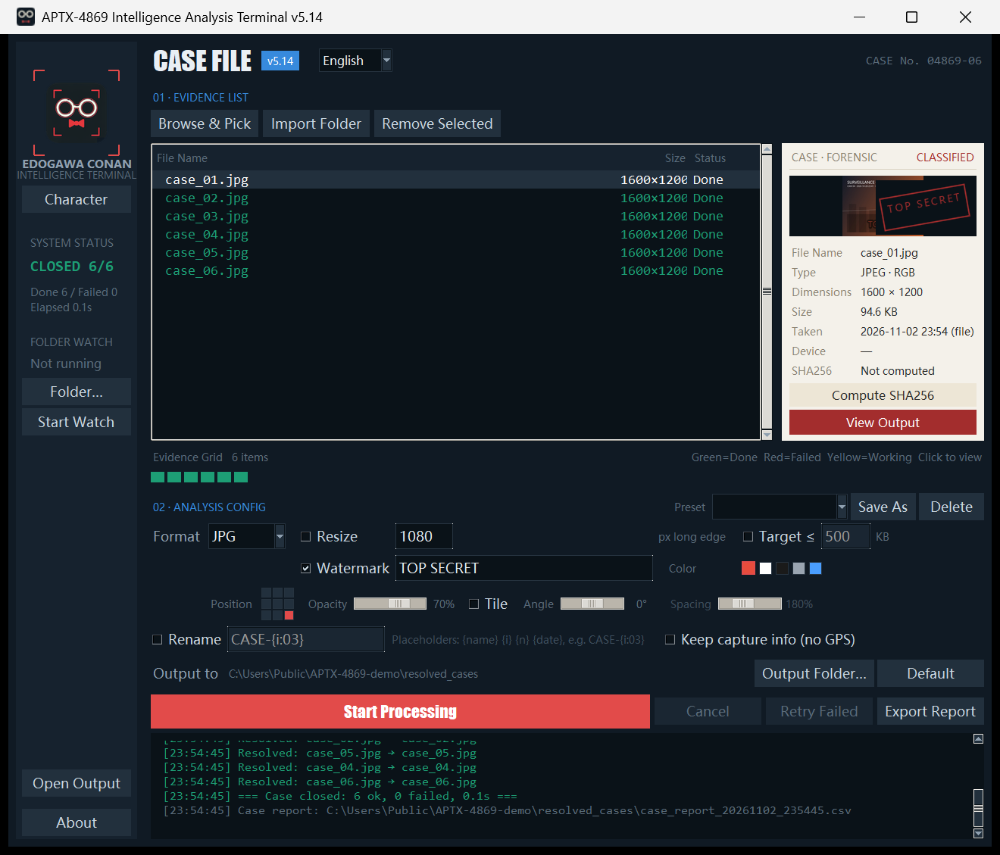

# APTX-4869 Intelligence Analysis Terminal · User Manual

> A batch image processor that lives on your desktop.
> Convert formats, resize, watermark, inspect the results — all in one window, entirely offline.

**English manual** · [中文说明](README.md) · **[Download the latest release](https://github.com/jinferth/aptx-4869/releases/latest)**



> Left: system status and folder watch · Middle: evidence list · Right: case card for the selected
> image (metadata and resulting output) · Bottom: analysis options and the per-file log

---

## Contents

1. [Quick Start](#1-quick-start)
2. [Interface Tour](#2-interface-tour)
3. [Standard Workflow](#3-standard-workflow)
4. [Processing Parameters](#4-processing-parameters)
5. [Evidence Grid & Output Preview](#5-evidence-grid--output-preview)
6. [Output Rules](#6-output-rules-important)
7. [Keyboard Shortcuts](#7-keyboard-shortcuts)
8. [FAQ](#8-faq)
9. [Release Notes](#9-release-notes)
10. [Known Limitations](#10-known-limitations)
11. [Roadmap](#11-roadmap)
12. [Files & Checksum](#12-files--checksum)

---

## 1. Quick Start

### Option A: run the executable (recommended)

Double-click `APTX-4869_v5.13.exe`.

- It is a **single file** and needs no installation. **The first launch takes 2–4 seconds** because it unpacks the bundled Python runtime into a temp directory; later launches are faster. This is not a hang — don't double-click repeatedly.
- It writes no registry entries, modifies no system files, and makes no network requests.
- Your settings live in `%APPDATA%\DetectiveToolbox\settings.json`, so the program folder itself stays clean and can be moved or deleted freely.

### Option B: run from source

Requires Python 3.10+ with tkinter (included in the official Windows installer) and Pillow:

```bash
pip install pillow
python image_processor_pro.py
```

Verified with `D:\Python314\python.exe` (3.14 + Pillow 12 + tkinter 8.6).

> If your default Python has no tkinter, it fails with `No module named 'tkinter'`. Use an interpreter that ships it.

---

## 2. Interface Tour

Two halves: a **dark sidebar** on the left, a **workbench plus case card** on the right.

```
┌──────────┬────────────────────────────────────────────┬──────────────┐
│ Viewfind.│  CASE FILE  v5.13          CASE No. 04869-07 │ CASE·FORENSIC│
│ icon     │                                            │ CLASSIFIED   │
│          │  01 · EVIDENCE LIST                         │ ┌──────────┐ │
│ EDOGAWA  │  [Browse & Pick][Import Folder][Remove Sel] │ │ thumbnail │ │
│ CONAN    │  ┌──────────────────────────────┐          │ │  TOP     │ │
│          │  │ File Name      Size     Status│          │ │ SECRET   │ │
│ SYSTEM   │  │ 1.jpg        200×400    Done │          │ └──────────┘ │
│ STATUS   │  │ broken.jpg            Failed│          │ File Name …  │
│          │  └──────────────────────────────┘          │ Type  Size … │
│ 6/7 FAIL │  Evidence Grid 7 items  ■■■■■■■           │ Taken  Dev … │
│ Prog 6/7 │  02 · ANALYSIS CONFIG                      │ SHA256 …     │
│          │  Format[JPG] ☐Resize ☐Target ☐Watermark     │ [View Output]│
│          │  Output to …\custom_out  [Folder…][Default] │ [Compute SHA]│
│ [Open    │  [Start Processing][Cancel][Retry][Report] │              │
│ folder]  │  log area                                   │              │
└──────────┴────────────────────────────────────────────┴──────────────┘
```

| Area | What it does |
|---|---|
| Viewfinder (top left) | The current "investigator" icon. Click **Character** to swap in a local image — lasts for this run only |
| SYSTEM STATUS | `READY · N` idle / `PROCESSING` working / `CLOSED 12/12` all good / `4/5 · 1 FAIL` some failed |
| Progress | Done/total with percentage, success and failure counts, elapsed time |
| Open folder (bottom left) | Lights up after the first run; jumps straight to the output folder |
| Evidence list | Three columns: file name, output size, status. Status is colour-coded: grey = pending, yellow = working, green = done, red = failed |
| Evidence grid | One small square per file — the whole batch at a glance, including which one broke (see §5) |
| Output to | Where outputs land. Default is `<folder of the first image>/resolved_cases`; **Folder…** changes it, **Default** restores it |
| Case card | Forensic details of the selected row: type, dimensions, file size, capture time, device, SHA256 |
| Log area | Timestamped run history. Green = success, red = failure, grey = notes |

---

## 3. Standard Workflow

1. **Add images** (three ways, pick one)
   - **Drag images or folders into the window** — fastest. Folders expand one level deep.
   - **Browse & Pick** — opens a file dialog; hold `Ctrl` to multi-select, thumbnails visible. Supports jpg / jpeg / png / bmp / webp / ico / tif / tiff / gif.
   - **Import Folder** — pulls in every supported image in a folder (**not** recursive).
   - Adding the same file twice is skipped automatically.

2. **Check the list**
   File names and statuses are shown. To remove one: select it and press `Delete`, click **Remove Selected**, or use the right-click menu. `Ctrl` / `Shift` select multiple rows.

3. **Choose parameters** (see §4)
   You can skip this entirely — the default is "convert to JPG, no resize, no watermark".

4. **Click Start Processing**
   Processing runs on a background thread, so the UI never freezes. Each row's status changes yellow → green/red in real time, and the evidence grid follows.

5. **Inspect the results**
   - A summary dialog appears: how many succeeded, how many failed, elapsed time, output location.
   - The first successful file is auto-selected and its details fill the case card.
   - Click **View Output** or double-click a row to open the output in the preview window.
   - Click **Open folder** in the sidebar to jump to the output directory.

6. **Three clean-up actions** (only when something failed, or you want the data)
   - **Cancel** — stop mid-run. The current file finishes, already-written outputs stay.
   - **Retry Failed** — the button shows the failure count; clicking it re-runs only the failures. Successful files are not processed twice.
   - **Export Report** — every run writes a CSV case report into the output folder; **Export Report** opens it.

7. **Let it watch a folder (optional)**
   In the sidebar's `FOLDER WATCH` section: pick a folder with **Folder…**, then click **Start Watch**.
   From then on, **any new image dropped into that folder is processed automatically** using the current parameters.

   This suits a fixed workflow: set format, resize and watermark once, leave the watcher on, and drop images into the folder.

   The rules (all there to avoid mistakes, not to restrict you):
   - **Files are processed only once they are fully written.** The program watches file size and modification time and only treats a copy as complete after two consecutive identical readings *and* at least 2 seconds since it first appeared. A large file copied halfway is never read, and never errors.
   - **Each file is processed once.** Tracked by path + size + modification time; overwriting a file with the same name counts as a new version.
   - **Outputs are never re-processed.** If the output folder sits inside the watched folder as `resolved_cases`, the scan skips it — otherwise you'd loop forever (process output → treat it as new).
   - **Files that arrive mid-run are queued** and picked up when the current batch ends; nothing is lost.
   - **No summary popup.** Only a log line, so you aren't interrupted every time a batch lands.
   - **One level deep only.** The watch state is not saved across restarts — click **Start Watch** again after relaunching (the folder is remembered).

8. **Switch the interface language**
   The `English` dropdown in the top-right header switches between 中文 and English **immediately** — no restart. The choice is remembered for next launch.

   Everything follows the switch, not just the buttons: list headers and the status column, the evidence grid, every analysis-config control, the watch panel, the run summary, the log, dialogs, the preview window, the window title — and even the **case report's headers and file name** (`case_report_<timestamp>.csv`).

   > Historical log lines are not retroactively translated; they record what was said at the time.
   > Your own saved preset names are not translated either — those are your naming, not ours.

9. **Keyboard shortcuts**

   | Shortcut | Action | Notes |
   |---|---|---|
   | `Ctrl+O` | Open the file picker | Ignored while processing |
   | `Ctrl+Enter` | Start processing | Ignored when the list is empty or already running |
   | `Esc` | Cancel the current run | Only active while processing |

   Parallel processing is on by default (multiple files at once on multi-core machines; the log shows `[PARALLEL] Processing in parallel, N worker threads`). Large images are downsampled before resizing, which keeps memory use down. To turn parallel processing off, set `parallel` to `false` in `%APPDATA%\DetectiveToolbox\settings.json`.

---

## 4. Processing Parameters

### Preset

The dropdown at the top-right of the config area applies a whole parameter set at once:

| Built-in preset | Effect |
|---|---|
| WeChat | JPG · long edge 1280 · target 300 KB · no watermark |
| Web WEBP | WEBP · long edge 1600 · target 200 KB · no watermark |
| Icon ICO | ICO · no resize · no watermark |
| Direct Convert | JPG · no resize · no size target · no watermark |

After tweaking parameters, click **Save As** and give it a name — your preset survives restarts. **Delete** only applies to your own presets; the four built-ins live in the code and cannot be deleted or corrupted, so a misclick can never leave you without a working set.

> A preset stores the full processing setup (format, resize, all seven watermark settings, target size, metadata). **The output folder is deliberately not part of a preset** — that is "where this batch goes", not "how it is processed".

### Format

`JPG` / `PNG` / `BMP` / `WEBP` / `ICO`

| Case | Behaviour |
|---|---|
| Converting to JPG / BMP | No alpha channel — transparent areas are **filled with white** (not black) |
| Converting to PNG / WEBP | Alpha channel preserved |
| Converting to ICO | Generates 16/24/32/48/64/128/256 px frames, but **never larger than the source**; icons top out at 256 px |

JPG uses a fixed quality of 95 with optimise enabled; WEBP uses quality 95. Neither number is adjustable yet.

### Resize

Tick the box and enter a pixel value (default 1080). The program scales the **long edge** down to that value, preserving aspect ratio:

- 4000×3000 with 1080 → 1080×810
- 800×600 with 1080 → **not enlarged**, stays 800×600
- Only digits are accepted; an invalid entry falls back to 1080 and is noted in the log

### Target size — optional, off by default

Tick it and enter a size in KB (default 500). The program adjusts quality — **without changing dimensions** — to the highest value that still fits the budget.

- **JPG / WEBP only.** With PNG / BMP / ICO the whole group greys out; a lossless format has no meaningful size target.
- How it works: binary search over quality (1–95) and keep the **highest quality that fits**. At most 7 in-memory encodes per image, no temp files.
- Images that are already small enough are left alone: a flat-colour image that is 15 KB stays at quality 95 even with a 60 KB target.
- It stacks with Resize — resize first, then cap the size. If you want both small and sharp, **resize first, then set the size cap**.

**You are told when the target cannot be met**: if quality 1 still exceeds it, that row is marked `*` in the report and a warning is summarised in the log. Quality being pushed below 20 also raises a warning — that usually means the image is simply too large and you should resize first.

### Watermark — optional, off by default

**This is the one feature you can leave completely unused**: with it off, not a single watermark pixel is written and the output is pixel-for-pixel identical to the source (verified with a lossless format).

While it is off, the position, opacity and tiling controls are greyed out and the thumbnail carries no overlay — so you can never have "it looks configured but did nothing", nor "I never set it but something appeared".

Once enabled, seven parameters are available:

| Parameter | Description |
|---|---|
| **Text** | Defaults to `TOP SECRET`; edit freely |
| **Colour** | Five swatches: red / white / black / grey / blue. Pick white or black on light backgrounds, white on dark; red and blue add a bit of theme |
| **Position** | The 3×3 picker on the left — any of nine positions, bottom-right by default |
| **Opacity** | 0–100% slider, 70% by default. 0% means nothing is drawn |
| **Tile** | Fills the whole frame in a staggered pattern; "position" is ignored in this mode |
| **Angle** | −45° to +45°, applies to both single and tiled placement; around −30° looks most natural for a diagonal |
| **Spacing** | 110%–320%, only available when tiling is on. Higher numbers spread the marks out |

Four fixed rules:

- The font scales with the image: starting at roughly 4% of the short edge (never below 10 px), shrinking further if the text would not fit.
- Order is **resize first, watermark second**, so the watermark is sized against the **output** dimensions, not the original.
- The outline colour inverts against the text luminance (dark text gets a light outline, light text a dark one) so it stays readable on any background. When tiling, an extra row and column are added at the edges so no clean white band is left behind.

**Live preview**: change the text, drag a slider or pick a position and the case-card thumbnail redraws immediately — no need to run a batch first.

> Known edge case: on a very small image (say 40×30) only a fragment of the watermark fits.

---

## 5. Evidence Grid & Output Preview

### Evidence grid

A row of small squares, one per file in the list:

| Colour | Meaning |
|---|---|
| Grey | Pending |
| Yellow | Working |
| Green | Done |
| Red | Failed |

- Hover shows the file name and status
- Click jumps to that row in the list and fills the case card
- Click a **green** square to open the output preview directly
- Beyond 120 files the right side shows `+N` for the ones not drawn

### Output preview window

| Action | Result |
|---|---|
| **Fit Window** | Shows the whole image; if it is smaller than the window it is *not* enlarged — it stays at native size, centred |
| **1:1** | Native size, scrollbars for the overflow |
| Mouse wheel | Zooms in fixed steps between 25% and 200% |
| Drag with the left button | Pans around a large image |
| **Compare Original** | Toggles between the source and the output, to check the resize / watermark result |
| **Open Folder** | Opens the folder containing the output |
| `Esc` | Closes the preview |

The top bar shows the image's true dimensions, the current zoom level and the file size.

> If a file failed to process, opening its preview falls back to the original. If the original itself is corrupt, you get a "cannot decode" message rather than an empty window.

---

## 6. Output Rules (important)

### Output location

Everything goes into a `resolved_cases` folder next to the **first image in the list**:

```
D:\Photos\2026\resolved_cases\1.jpg
```

That folder is created automatically the first time you click Start Processing.

Click **Folder…** in the config area to use a different location — it is remembered across restarts. Click **Default** to go back to the rule above.

> One consequence of the default rule: if you import images from **two different folders** without setting an output folder, every output lands in the **first** folder's `resolved_cases`. Set an explicit output folder to avoid that.

### File naming

- By default the original name is kept and only the extension changes: `photo.jpg` → `photo.png`
- **Nothing is overwritten**: if the target exists, a suffix is added — `photo_1.png`, `photo_2.png`
- So re-running the same batch never loses files, but it does accumulate `_1` / `_2` copies that you may want to clean up

### Orientation

The EXIF orientation tag is applied automatically. Photos taken in portrait come out upright, not sideways.

### Rename (batch renaming) — optional, off by default

Tick it and enter a naming template; outputs are renamed to match. Four placeholders are supported:

| Placeholder | Meaning | Example |
|---|---|---|
| `{name}` | Original file name (without extension) | `photo` |
| `{i}` | Index, starting at 1 | `7` |
| `{i:03}` | Index, zero-padded to 3 digits | `007` |
| `{n}` | Total in this batch | `20` |
| `{date}` | Processing date | `20261029` |

Some examples:

```
CASE-{i:03}        →  CASE-001.jpg  CASE-002.jpg  …
{date}-{i:04}      →  20261029-0001.jpg
{name}_web         →  photo_web.jpg  (keeps the original name, adds a suffix)
```

Three behavioural notes:

- **The index follows list order** — exactly what you see. Reorder the list first if you want a different order.
- Illegal Windows characters in the template (`\ / : * ? " < > |`) are replaced with underscores, so one stray character cannot fail the whole batch.
- Name collisions still do not overwrite: `_1` and `_2` are added, so running the same batch twice produces two sets of files rather than clobbering the first.

> Renaming only affects **output** file names. The evidence list keeps showing the original names; the mapping from "source → output" is recorded in the case report.

### Metadata (capture information)

By default **no metadata is kept at all** — no camera model, no capture time, and certainly no GPS coordinates.

To keep capture information, tick **Keep capture info (no GPS)** at the bottom of the config area:

| Kept | Dropped |
|---|---|
| Camera make | **GPS coordinates** |
| Camera model | Vendor-private MakerNote |
| Capture time (DateTime / DateTimeOriginal) | Thumbnails, lens, exposure and every other field |

This is a deliberate trade-off: when tidying photos, "which machine took this and when" is useful; "which exact coordinates" is the one thing that should not travel with the file. There is no "keep everything" option, only this whitelist.

> Applies to JPG / WEBP only. PNG, BMP and ICO have no standard EXIF carrier, so nothing is written even when the box is ticked.

### Case report

After each run, the output folder receives `case_report_<YYYYMMDD>_<HHMMSS>.csv`, one row per image:

| Column | Contents |
|---|---|
| No. / File Name / Status | Success or failure |
| Source Size → Output Size | e.g. 5000×3000 → 1200×720 |
| Source File Size → Output File Size | Plus the percentage change (`-44.3%`) |
| Quality | The final JPEG/WEBP quality (1–95); a trailing `*` means quality 1 still exceeded the target |
| Time (ms) | Per-file processing time, useful for finding what is slowing a batch down |
| Output File / Error | The reason, when the file failed |

It opens cleanly in Excel (the file carries a BOM). Multiple runs produce multiple reports — the timestamp keeps them from overwriting each other.

### Original files

**Your originals are never modified.** Everything is done in memory and written to new files.

---

## 7. Keyboard Shortcuts

| Where | Key | Action |
|---|---|---|
| Evidence list | `Delete` / `BackSpace` | Remove selected items |
| Evidence list | Double-click | Open the output preview |
| Evidence list | Right-click | Menu: view output / remove this item / clear list |
| Anywhere in the window | Drop files | Import images; dropping a folder expands one level |
| Preview window | `Esc` | Close |
| Preview window | `+` / `-` | Zoom in / out one step |
| Anywhere | `Ctrl+O` | Add images |
| Anywhere | `Ctrl+Enter` | Start processing |
| Anywhere | `Esc` | Cancel the running batch |

---

## 8. FAQ

**Q: Double-clicking the exe does nothing for a few seconds.**
Single-file bundles unpack the runtime on first launch; 2–4 seconds is normal. Later launches are quicker.

**Q: The batch seems stuck on one file.**
Very large images (8000×6000) take time to decode and the progress pauses on that one. Let it finish. If it is genuinely wedged you can close and reopen the app — the originals are untouched.

**Q: Why is there a `xxx_1.jpg`?**
A file with that name already existed in the output folder. Nothing is overwritten; a new name is used instead. Clearing the old `resolved_cases` folder avoids the clutter.

**Q: Why did my transparent PNG come out with a white background?**
JPG and BMP cannot store transparency, so it is flattened onto white. Choose PNG or WEBP if you need the alpha channel.

**Q: Can I move the watermark?**
Yes — the 3×3 picker next to **Position** offers nine placements, plus tiling, colour, opacity and angle.

**Q: Dragging does nothing.**
Only image files and folders can be dropped, and drops are refused while a batch is running (the log says so). If the first log line says drag-and-drop is unavailable, the drag component is missing in this environment — use **Browse & Pick** instead; nothing else is affected.

**Q: Does cancelling undo the files already written?**
No. Cancel only stops further work; everything already written is kept, and the report is still produced.

**Q: A few files always fail.**
Look at the red lines in the log. Usual causes: the file is corrupt or truncated; the extension lies about the actual format; another program holds a lock on it; or the source directory is not writable. A failure affects only that file — the rest of the batch completes.

**Q: Do I have to re-enter the parameters every time?**
No. Format, resize, watermark and output folder are all remembered and restored on the next launch. To reset to factory defaults, close the app and delete `%APPDATA%\DetectiveToolbox\settings.json`.

**Q: The window does not fit on a small screen.**
The height is computed from the content, and the window is clamped to the screen when it does not fit — the log area may get squeezed. 1080p or better is recommended.

**Q: Can I share, modify or redistribute this?**
Yes — it is MIT licensed. Use it, change it, ship it, commercially if you like. The only requirement is keeping the copyright notice and the licence text.

**Q: Is the program safe to share?**
It is not code-signed, so Windows SmartScreen may show a warning on download — click "More info → Run anyway". The release folder includes a `SHA256.txt`; compare it with `Get-FileHash` to confirm the file you have is the one that was published.

---

## 9. Release Notes

The tool went from v5.2 to v5.13 over a series of focused changes: **correctness first, then the visual design, then everyday friction**. The order matters — a program that freezes gets ignored no matter how pretty it is, and a pretty program that forgets your settings gets ignored too.

| Version | What changed |
|---|---|
| v5.3 | Stability: the worker thread no longer touches Tk widgets (queue + main-thread pump); full try/finally around the pipeline; EXIF orientation correction |
| v5.4 | Visual rewrite: dark-room + case-file look, evidence grid, output preview window |
| v5.5 | Everyday friction: settings memory, custom output folder, cancel, retry-failed, CSV case report, drag & drop |
| v5.6 | Watermark: 3×3 positioning, opacity, tiling, live preview |
| v5.7 | Target size: binary-search the quality to hit a KB budget |
| v5.8 | Watermark colour, angle and tiling spacing |
| v5.9 | Presets and optional capture-info retention |
| v5.10 | Batch renaming with templates |
| v5.11 | Folder watching |
| v5.12 | Performance: parallel batches, large-image downsampling, global shortcuts |
| v5.13 | English/Chinese interface, About dialog, reproducible build |

---

## 10. Known Limitations

Honest list of what it does not do:

1. **No recursion into subfolders.** Importing a folder or dropping one scans one level only.
2. **Quality cannot be set by hand.** Without a target size it is fixed at 95; with one, the binary search decides — you control the size, not the number.
3. **ICO output tops out at 256 px**, and never exceeds the source dimensions.
4. **Very large batches of huge images still cost memory.** Downsampling before resize helps, but dozens of 8000 px images at once will still be heavy.
5. **The top line of the log is half-cut when scrolled to the bottom.** Every scrollable text box does this; it does not affect use.
6. **Previewing a huge image at 1:1 costs memory**, because a bitmap of the original size is created.
7. **Cancel is not instantaneous.** The current file finishes first, which is noticeable on a very large image.
8. **Drag & drop depends on a third-party component.** It is bundled in the packaged build; from source without `tkinterdnd2` it disables itself and everything else still works.

---

## 11. Roadmap

| Direction | Status |
|---|---|
| Parallel batches | Done — thread pool, up to 8 workers |
| Large-image memory | Done — `Image.draft()` downsampling before resize |
| Global shortcuts | Done — `Ctrl+O` / `Ctrl+Enter` / `Esc` |
| List virtualisation | Not planned — Tk's Treeview has no native support and the usual batch sizes do not need it |
| Crop / rotate / flip | Not planned — it would turn a batch tool into a photo editor |
| More languages | The language registry is in place; adding one means writing a dictionary |

---

## 12. Files & Checksum

A release folder contains:

| File | Description |
|---|---|
| `APTX-4869_v5.13.exe` | The program, English name |
| `侦探工具箱_v5.13.exe` | The same binary under its Chinese name |
| `README_EN.md` | This manual |
| `README.md` | 中文说明 |
| `SHA256.txt` | Checksums for both executables |
| `LICENSE` | The MIT licence text |
| `RELEASE_NOTES.md` | Release summary |

Verify the download:

```powershell
Get-FileHash .\APTX-4869_v5.13.exe -Algorithm SHA256
```

The result should match the entry in `SHA256.txt`.

Building from source:

```bash
python build.py            # current version
python build.py --bump minor
python tests/run_all.py    # regression suite
```

---

*APTX-4869 Intelligence Analysis Terminal — released under the MIT License (see `LICENSE`). Free to use, modify and redistribute; keep the copyright notice and you are done.*
